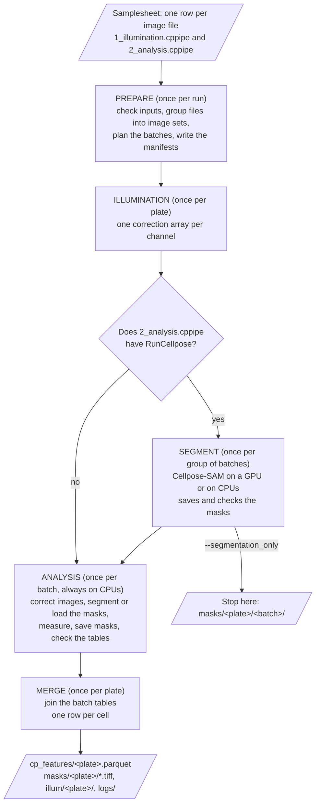

# Headless CellProfiler

Run CellProfiler on microscopy plates with Nextflow to produce label masks and one combined table of cell measurements.

**You must provide your own CellProfiler pipelines.** The workflow needs two files: `1_illumination.cppipe` and `2_analysis.cppipe`.
Make them for your images: your channels, your objects and your measurements.
The files in `cp-configs/` are examples for one screen. They do not fit other images.
See [provide your own pipelines](docs/usage.md#provide-your-own-pipelines).

## Quick start

First install Nextflow and prepare the images using the [installation guide](docs/getting-started/installation.md).
Run these commands from the repository folder. Replace `<samplesheet.csv>` with your samplesheet: one row per image file.
To make it from a folder of plate folders, see [Prepare the inputs](docs/usage.md#prepare-the-inputs).
Replace `<configs>` with the folder that holds your two pipeline files.
The full workflow example was not rerun during this documentation update.

```bash
conda env create -f environment.yml
conda activate cp-headless
nextflow run . -profile local --input <samplesheet.csv> --configs <configs> --project my_run
```

Results go to `projects/my_run/`, unless that name belongs to another run.
Nextflow prints the actual output path. Both supplied profiles preserve work files.
On the Berzelius cluster, follow [Run on Berzelius](docs/how-to/run-on-hpc.md).

## How the workflow runs

A **batch** is a group of complete image sets from one plate (default: 9 image sets).
Each step below is a Nextflow process. A plate does not wait for other plates.



- **Without RunCellpose**, CellProfiler segments the cells inside ANALYSIS, and there is no SEGMENT step.
- **With RunCellpose**, SEGMENT runs first. ANALYSIS then loads the masks that SEGMENT saved.
  The batches of a group start as soon as their group is segmented, so a GPU can segment the next group while CPUs measure the last one.
- **With `--segmentation_only`**, the run stops after SEGMENT. Check the masks, then run the same command without the flag.
  Nextflow reuses ILLUMINATION and SEGMENT, and runs only ANALYSIS and MERGE.
- **Every task** is its own Slurm job on Berzelius. A task that the system stops (out of memory or time) retries with more memory and time.

See [workflow](docs/explanation/workflow.md) for the details of each step.

## Documentation

Start with the [documentation home](docs/index.md), [first run](docs/tutorials/first-run.md),
or [troubleshooting](docs/how-to/troubleshooting.md).
The MkDocs site includes job diagrams, setup, inputs, outputs, and generated reference pages.
See [preview and build instructions](docs/about/contributing.md).
The hosted documentation is at <https://mirandaresearchlab.github.io/headless-cp-wf/>.

## Citation

No project DOI or citation file is supplied. Record the code revision, pipeline files,
and environment versions used for your analysis. See [citation guidance](docs/about/citation.md).

## License

No license file is supplied in this checkout. Ask the maintainers about reuse permissions.
