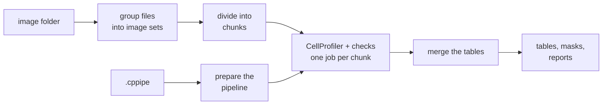

# cp-headless

cp-headless runs a CellProfiler pipeline on large sets of microscope images, with many jobs at the same time.
It gives you checked feature tables and segmentation masks for image-based profiling.

[](https://mirandaresearchlab.github.io/headless-cp-wf/)
[](https://github.com/mirandaresearchlab/headless-cp-wf/actions/workflows/ci.yml)
[](https://github.com/mirandaresearchlab/headless-cp-wf/actions/workflows/docs.yml)

## What it does

You give the workflow a **CellProfiler pipeline** (a `.cppipe` file that you made in the CellProfiler program)
and a **folder of images**. The workflow runs CellProfiler without its window ("headless"). It uses
**Nextflow** to run many CellProfiler jobs at the same time, on a laptop or on a computer cluster. You get:

- **feature tables**: one row per image and one row per cell (or other object), with measurements such as
  size, shape and intensity,
- **segmentation masks**: one image per object type that shows where each object is,
- **reports** that show what the workflow did, which checks it made, and which software it used.

Wrong or missing data in the tables gives wrong biology. Thus the workflow checks the data at each step, for
example for missing channels, lost masks or sites that occur twice. It stops when something is wrong.



## Quickstart

You need Nextflow 24.04 or newer, Java 17 to 26, and Docker.

See [Run on your own computer](https://mirandaresearchlab.github.io/headless-cp-wf/how-to/run-on-your-computer/) for each step from
`git clone`, including how to install Nextflow and how to select a supported Java.

```bash
git clone https://github.com/mirandaresearchlab/headless-cp-wf.git
cd headless-cp-wf
nextflow run . -profile test,docker
```

This runs CellProfiler on 6 small test images. It ends with `[SUCCESS] completed=5 failed=0 cached=0`, and
writes the tables, masks and reports to `results_test/` (see
[Output](https://mirandaresearchlab.github.io/headless-cp-wf/output/)).

Run your own data:

```bash
nextflow run . -profile docker --pipeline analysis.cppipe --input_dir images/ --outdir results/ \
    --group_regex '^(.+?_s\d+)_w\d' --chunk_size 50
```

## Documentation

Full documentation: **<https://mirandaresearchlab.github.io/headless-cp-wf/>**

- [Tutorial: first run](https://mirandaresearchlab.github.io/headless-cp-wf/tutorials/first-run/) on the test data
- [Run on your data](https://mirandaresearchlab.github.io/headless-cp-wf/usage/), and what the
  [output](https://mirandaresearchlab.github.io/headless-cp-wf/output/) contains
- How-to guides, for example
  [Run on a Slurm cluster](https://mirandaresearchlab.github.io/headless-cp-wf/how-to/run-on-hpc/) and
  [Run on Berzelius](https://mirandaresearchlab.github.io/headless-cp-wf/how-to/run-on-berzelius/)
- [Parameters](https://mirandaresearchlab.github.io/headless-cp-wf/reference/parameters/),
  [file formats](https://mirandaresearchlab.github.io/headless-cp-wf/reference/file-formats/) and
  [troubleshooting](https://mirandaresearchlab.github.io/headless-cp-wf/how-to/troubleshooting/)
- [How the workflow works](https://mirandaresearchlab.github.io/headless-cp-wf/explanation/workflow/) and
  [the data checks](https://mirandaresearchlab.github.io/headless-cp-wf/explanation/design/)

The pages are also in [`docs/`](docs/) in this repository.

## Repository layout

```text
headless-cp-wf/
├── main.nf, nextflow.config   the workflow and its settings
├── nextflow_schema.json       description of each parameter
├── conf/                      settings for Slurm and Berzelius
├── bin/                       Python helper scripts that run in each job
├── scripts/                   development, test and Berzelius scripts
├── tests/                     tests and the 6 test images
├── docs/, mkdocs.yml          the documentation site
└── Dockerfile                 the all-in-one image (Nextflow + CellProfiler)
```

## Citation

If you use cp-headless, cite this repository and the version that you used, and also CellProfiler and
Nextflow. See [How to cite](https://mirandaresearchlab.github.io/headless-cp-wf/about/citation/).

## Contributing

See [Contributing](https://mirandaresearchlab.github.io/headless-cp-wf/about/contributing/). A change to code
includes its tests and its documentation, in the same commit. See also the [changelog](CHANGELOG.md).

## License

This repository has no license file yet.
