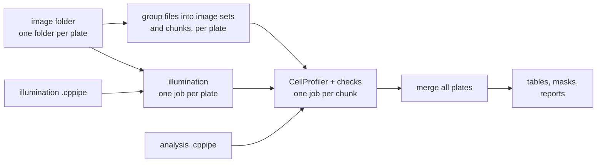

# cp-headless

cp-headless runs CellProfiler on large sets of microscope images, plate by plate, with many jobs at the same
time. It gives you checked feature tables of all plates and segmentation masks for image-based profiling.

[](https://mirandaresearchlab.github.io/headless-cp-wf/)
[](https://github.com/mirandaresearchlab/headless-cp-wf/actions/workflows/ci.yml)
[](https://github.com/mirandaresearchlab/headless-cp-wf/actions/workflows/docs.yml)

## What it does

You give the workflow **two CellProfiler pipelines** (`.cppipe` files that you made in the CellProfiler
program: an illumination pipeline and an analysis pipeline) and a **folder of images with one sub-folder per
plate**. The workflow runs CellProfiler without its window ("headless"). It uses **Nextflow** to run many
CellProfiler jobs at the same time, on a workstation or on the Berzelius cluster:

- one job per plate calculates the **illumination functions** of the plate,
- the analysis (for example **Cellpose** segmentation and the features) runs in chunks of sites, each chunk with
  the functions of its own plate.

You get:

- **feature tables** of all plates: one row per image and one row per cell (or other object), with
  measurements such as size, shape and intensity,
- **segmentation masks**: one image per object type that shows where each object is,
- **reports** that show what the workflow did, which checks it made, and which software it used.

Wrong or missing data in the tables gives wrong biology. Thus the workflow checks the data at each step, for
example for missing channels, lost masks or sites that occur twice. It stops when something is wrong.



## Where it runs

| Environment | How CellProfiler runs | Guide |
| --- | --- | --- |
| Lab workstation (Ubuntu, `root`) | Without Docker (`-profile local`) | [Installation](https://mirandaresearchlab.github.io/headless-cp-wf/getting-started/installation/), then [Run without Docker](https://mirandaresearchlab.github.io/headless-cp-wf/how-to/run-without-docker/) |
| Lab workstation (Ubuntu, `root`) | With Docker (`-profile docker`) | [Installation](https://mirandaresearchlab.github.io/headless-cp-wf/getting-started/installation/), then [Run with Docker](https://mirandaresearchlab.github.io/headless-cp-wf/how-to/run-with-docker/) |
| Berzelius (NSC) | Apptainer, interactive or Slurm batch (`-profile berzelius`) | [Berzelius: set up](https://mirandaresearchlab.github.io/headless-cp-wf/how-to/berzelius-setup/) |

## Quickstart

On a lab workstation with Nextflow and Docker ready (see the guides above):

```bash
git clone https://github.com/mirandaresearchlab/headless-cp-wf.git
cd headless-cp-wf
nextflow run . -profile test,docker
```

This runs CellProfiler on 6 small test images in two plate folders. The tables in
`results_test/cellprofiler_tables/` then have 6 image sets and 51 nuclei (see
[Output](https://mirandaresearchlab.github.io/headless-cp-wf/output/)). Run your own data:

```bash
nextflow run . -profile docker \
    --illum_pipeline 1_illumination.cppipe --pipeline 2_analysis_cellpose.cppipe \
    --input_dir images/ --outdir results/ --group_regex '^(.+?_s\d+)_x' \
    --container <the Cellpose image>
```

## Documentation

Full documentation: **<https://mirandaresearchlab.github.io/headless-cp-wf/>**

- [Tutorial: first run](https://mirandaresearchlab.github.io/headless-cp-wf/tutorials/first-run/) on the test data
- [Run on your data](https://mirandaresearchlab.github.io/headless-cp-wf/usage/), and what the [output](https://mirandaresearchlab.github.io/headless-cp-wf/output/) contains
- [Find your guide](https://mirandaresearchlab.github.io/headless-cp-wf/how-to/): lab workstation (with or without Docker) or Berzelius (interactive or batch)
- [Parameters](https://mirandaresearchlab.github.io/headless-cp-wf/reference/parameters/), [file formats](https://mirandaresearchlab.github.io/headless-cp-wf/reference/file-formats/) and
  [troubleshooting](https://mirandaresearchlab.github.io/headless-cp-wf/how-to/troubleshooting/)
- [How the workflow works](https://mirandaresearchlab.github.io/headless-cp-wf/explanation/workflow/) and [the data checks](https://mirandaresearchlab.github.io/headless-cp-wf/explanation/design/)

The pages are also in [`docs/`](docs/) in this repository.

## Repository layout

```text
headless-cp-wf/
├── main.nf, nextflow.config   the workflow and its settings
├── nextflow_schema.json       description of each parameter
├── conf/                      settings for Slurm and Berzelius
├── bin/                       Python helper scripts that run in each job
├── cp-configs/                the PANC1 pipelines (illumination, analysis) and a Berzelius params file
├── cp-plugins/                the CellProfiler plugins RunCellpose and EnforceObjectsOneToOne
├── containers/                the Cellpose image of the jobs
├── scripts/                   development, test, Docker-in-container and Berzelius scripts
├── tests/                     tests and the 6 test images
├── docs/, mkdocs.yml          the documentation site
└── Dockerfile                 the all-in-one image (Nextflow + CellProfiler)
```

## Citation

If you use cp-headless, cite this repository and the version that you used, and also CellProfiler and
Nextflow. See [How to cite](https://mirandaresearchlab.github.io/headless-cp-wf/about/citation/).

## Contributing

See [Contributing](https://mirandaresearchlab.github.io/headless-cp-wf/about/contributing/). A change to code
includes its tests and its documentation, in the same commit. See also the [changelog](CHANGELOG.md).

## License

This repository has no license file yet.
