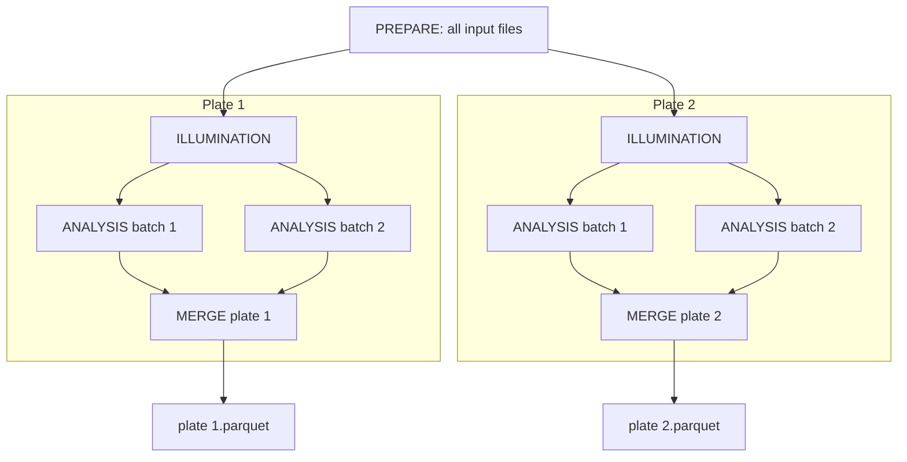
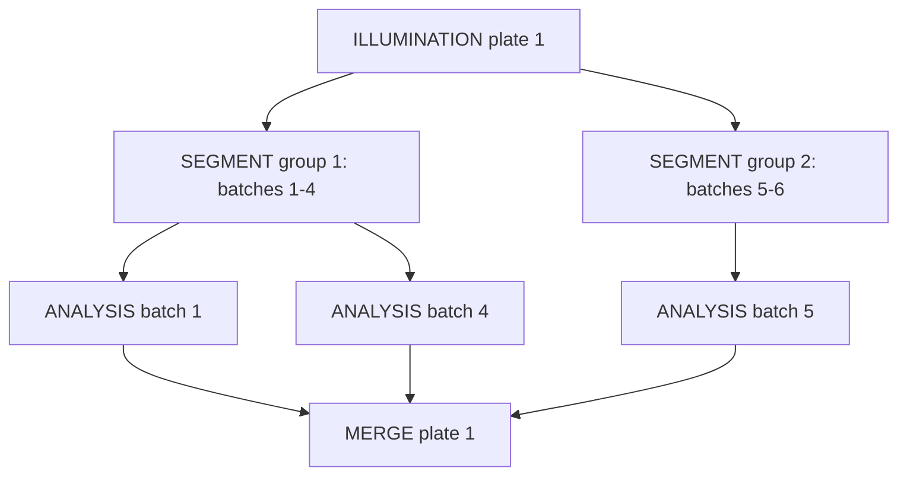
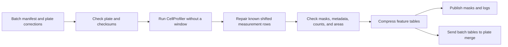

# How jobs run

Nextflow starts each job when its inputs are ready and execution resources are available.
A job is one execution of a process. A process is a named step in `modules/local/`.

## Dependencies between plates

Each plate's analysis waits for that plate's illumination files.
It does not wait for other plates to finish illumination.
A plate merge waits for all batches from its own plate.
No step waits for all plates. Resource limits can still delay any ready job.

## Dependencies with Cellpose-SAM

If `2_analysis.cppipe` has RunCellpose modules, a SEGMENT step runs between ILLUMINATION and ANALYSIS.
One SEGMENT job segments a group of `--segmentation_batches` batches of one plate.
It runs on a GPU or on CPUs (`--segmentation gpu` or `cpu`). ANALYSIS always runs on CPUs.

Each batch gets the masks of its own SEGMENT group, matched by plate and batch name.
The run stops if a batch has no masks or two sets of masks.
The ANALYSIS jobs of a group start when that group is complete.
They do not wait for the other groups. So a GPU segments the next group while CPUs measure the last one.
See [segmentation choices](segmentation.md) for the checks on each mask.

## What each step does

| Process | Jobs | Actions and outputs |
|---|---|---|
| PREPARE | One per run | Check samplesheet rows, channels, dimensions, and pipelines. Write manifests, batch plan, adapted pipelines, and contract. |
| ILLUMINATION | One per plate | Read every image set of that plate. Save one correction array per channel after the last cycle. Check shape and finite values. |
| SEGMENT | One per group of batches, only with RunCellpose | Run RunCellpose and the modules that make its input image. Save one mask per image set and object. Check each mask against its image set and files. |
| ANALYSIS | One per batch | Check correction checksums. Correct images, segment objects (or load the SEGMENT masks), measure features, save masks, and validate tables. |
| MERGE | One per plate | Require validated batches. Join cell, nucleus, cytoplasm, and image measurements into one row per cell. Write the published `<plate>.parquet` with fixed column types, read it back, and check rows, order and cell identity. |

A batch contains consecutive complete image sets from one plate.
It never splits channels or mixes plates.
PREPARE sorts the image sets of a plate by well, then site, then the other metadata columns by name.
Numbers inside a value compare as numbers, so site 2 comes before site 10 and well A2 before A10.
For P plates and B total analysis batches, a successful run requires `2 + 2P + B` tasks, excluding retries.
B is the sum of each plate's image-set count divided by batch size, rounded up separately for each plate.
With RunCellpose, add one SEGMENT task for each group: the batches of each plate divided by `--segmentation_batches`, rounded up.

## What happens inside an analysis job

The repair handles a known CellProfiler 4.2.8.1 behavior for objects without pixels.
It moves shifted shape and texture values back to their object rows and records the changes.
An unexpected shift pattern stops the task rather than accepting uncertain measurements.

The local executor runs jobs on the current machine.
The Berzelius executor submits them to Slurm, the cluster's job scheduler.
Both profiles retry task exit statuses 137 and 143 within their retry limits.
Other failures terminate the workflow. A retry uses the same resource request.
A killed CellProfiler child can produce a Python failure with a different status, so it may not trigger automatic retry.

See [resources](../reference/resources.md), [outputs](../output.md), and [design limits](design.md).
