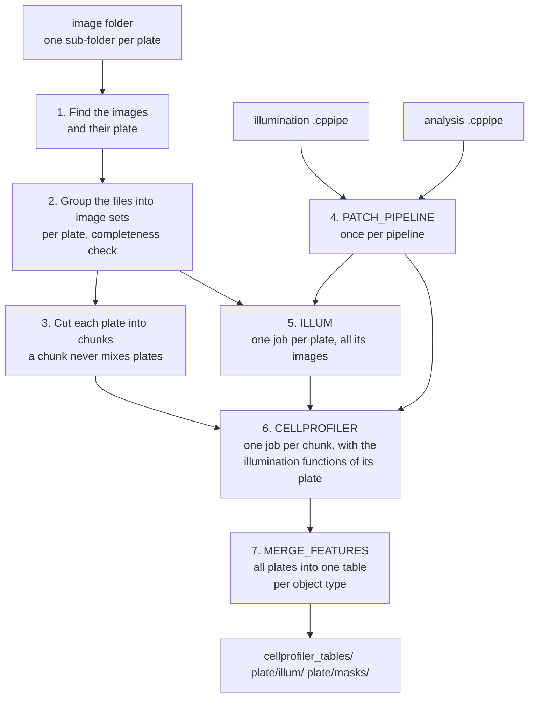

# How the workflow works

This page explains each step of the workflow: what it does, which tool runs it, and why. The code is in
[`main.nf`](https://github.com/mirandaresearchlab/headless-cp-wf/blob/main/main.nf).



For each plate the jobs run in this order: ILLUM, then the chunks of the plate, then (after all plates) the
merge. All plates run in the same run, at the same time:

```text
plate 1:  ILLUM ──► chunk 1, chunk 2, ... chunk N ──┐
plate 2:  ILLUM ──► chunk 1, chunk 2, ... chunk N ──┼──► MERGE_FEATURES
plate N:  ILLUM ──► chunk 1, chunk 2, ... chunk N ──┘
```

## 1. Find the images and their plate

**Tool:** Nextflow. The workflow searches `--input_dir` and all its sub-folders for files with one of the
extensions in `--extensions`. It skips hidden files. Each file becomes its path relative to the image folder,
for example `PANC1_P01/A02_s1_x0_y0_Fluorescence_405_nm_Ex.tiff`.

Each file gets a **plate**: the first folder of its path (here `PANC1_P01`), or capture group 1 of
`--plate_regex`. The run stops if a file has no plate (for example a file directly in `--input_dir`), or if a
plate name has characters other than letters, digits, `.`, `_` and `-`. **Why:** the plate name becomes a folder
and a file name in the results, and the value of `Metadata_Plate`.

## 2. Group the files into image sets

**Tool:** Nextflow. The capture groups of `--group_regex` make a key for each file. Files with the same plate and
key belong to the same site and form one image set. Without `--group_regex`, each file is an image set of its own.

Then the workflow checks the image sets of each plate. Every file must match the pattern, and every image set
must have the same number of files (the most common number is the channel count). Otherwise the run stops,
unless `--allow_incomplete_sets true`. **Why:** a site with a missing channel, or a stray file in the image
folder, gives image sets that CellProfiler cannot build correctly.

## 3. Cut each plate into chunks

**Tool:** Nextflow. The workflow sorts the image sets by plate, then by key, and cuts each plate into chunks of
`--chunk_size` image sets (default 50; 0 = one chunk per plate). The last chunk of a plate may be smaller. A
chunk always holds complete image sets of one plate. Its name tells the plate: `PANC1_P01_chunk_0001`.
**Why sorted:** the chunks are the same in each run, which `-resume` needs.

The log then shows each plate, for example `PANC1_P01: 3456 image set(s) of 5 file(s), 70 chunks x 2 cores x
8 GB`. `pipeline_info/run_info.json` gets the plates with their sites and chunks.

## 4. Prepare the pipelines (PATCH_PIPELINE)

**Tool:** `bin/patch_cppipe.py`, with CellProfiler's own Python API, in the CellProfiler container. It runs
once per pipeline.

For both pipelines:

1. Load the pipeline. Stop if CellProfiler reports any problem (for example a missing plugin).
2. Remove CreateBatchFiles, which stops a run without a window.
3. Move output folders that point outside the job (or into the image folder) into the job folder.

For the illumination pipeline (`--illum_pipeline`): stop if it has no CorrectIlluminationCalculate, or no
SaveImages that saves a function as `.npy` at the last cycle. It gets no masks and no tables.

For the analysis pipeline (`--pipeline`):

1. Stop if `--chunk_size` is more than 0 and the pipeline has a module that needs all image sets, for example
   CorrectIlluminationCalculate with "All: Across cycles". That module belongs in the illumination pipeline.
2. Set each RunCellpose module to run Cellpose in the Python of the container (not in Docker), without a GPU.
3. With illumination functions: make the Images module pass `.npy` files ("Images only" drops them).
4. For each object type in `--mask_objects`: add ConvertObjectsToImage (16-bit labels) and SaveImages. Masks
   are never overwritten: two image sets with the same mask file stop the run.
5. Add ExportToSpreadsheet if the pipeline has none. Make it write `Image.csv`, `Cells.csv`, ... into the job
   folder without a prefix, with the image metadata in each object table.

The results are in `pipeline/`. **Why:** the same pipeline must give masks and tables with the same names in
every job, and must never write into the image folder.

## 5. Calculate the illumination functions (ILLUM)

**Tool:** CellProfiler (`cellprofiler -c -r`), then `bin/check_illum.py`, in the CellProfiler container. One
job per plate, with all images of the plate in one CellProfiler run: the function of a channel is the average
of all its images. It is never cut into chunks.

`check_illum.py` checks that there is one `.npy` file per SaveImages module, and that all values are finite and
greater than 0. The functions go to `<plate>/illum/`. With `--illum_dir`, the workflow skips this step and uses
the functions of an earlier run instead.

## 6. Run CellProfiler on each chunk (CELLPROFILER)

**Tool:** CellProfiler 4.2.8 (`cellprofiler -c -r`), then `bin/check_chunk.py`, in the CellProfiler
container. One job per chunk.

A chunk gets the illumination functions of **its own plate** only: the workflow joins chunks and functions by
the plate name. The functions come after the images in the file list of CellProfiler (`--file-list`); the
NamesAndTypes module of your pipeline gives them their names (for example files that start with `IllumDNA`),
as in the CellProfiler program. They add no image set: every site of the chunk uses the same function.

The job links the complete image folder as `input/`. Thus the folder structure stays the same, and metadata
from folder names still works. CellProfiler can end with exit code 0 after errors. Thus `check_chunk.py`
checks the outputs:

- no errors in the CellProfiler log while modules ran,
- an image table with the expected number of image sets (the number of sites),
- counts that agree with the object tables,
- one mask per image set and object type, and no two image sets with the same mask,
- the plate in every row (`Metadata_Plate`; it adds the column if the pipeline does not make it),
- with `--required_metadata`: present, non-empty and unique metadata.

## 7. Merge the tables (MERGE_FEATURES)

**Tool:** `bin/merge_features.py`. It runs once, after all chunks of all plates (`--merge_all_plates false`:
once per plate). For each table name, it joins the tables of all chunks into one table, row by row. It
rewrites `ImageNumber` so that it is unique over all plates and chunks, and keeps the original values in
`CPNF_Chunk` and `CPNF_ChunkImageNumber`. It stops if:

- two chunks wrote the same mask path,
- the same plate, well and site occur twice,
- a row of an image or object table has no plate,
- with `--check_compartments true` (the default): a table or a column is missing that joins the compartments
  of each cell (`Image`, `Cells`, `Nuclei`, `Cytoplasm`; `ImageNumber`, `ObjectNumber`, `Parent_Cells`,
  `Parent_Nuclei`, plate, well and site).

The merged tables are the end of the workflow. A tool that makes single-cell profiles can read them as they
are: each cytoplasm object joins to its cell and its nucleus with `Parent_Cells` and `Parent_Nuclei`, and to
its image with `ImageNumber`.

## Cores, memory and waiting jobs

One run handles all plates. The limits count the jobs of all plates together:

- An analysis chunk asks for `--segmentation_cpus` cores (default 2) and `--memory_per_cpu` per core (default
  4 GB, so 8 GB). Cellpose (PyTorch) uses exactly these cores. An ILLUM job asks for 1 core and 8 GB.
- `--total_cpus` is the most cores that the run uses at once. On a workstation, Nextflow starts a job only when
  its cores (and `--total_memory`) are free. On Slurm and Berzelius, at most `total_cpus / segmentation_cpus`
  jobs are in the queue or running. The other jobs wait in Nextflow, and start when a job ends.
- The ILLUM jobs are ready first, so they start first. A plate's chunks start as soon as its own ILLUM job is
  done and cores are free: a slow plate does not hold back the other plates.

| `--total_cpus` | `--segmentation_cpus` | Chunks at once | Memory in use |
| --- | --- | --- | --- |
| 8 | 2 | 4 | 32 GB (8 GB each) |
| 16 | 2 | 8 | 64 GB (8 GB each) |
| 16 | 4 | 4 | 64 GB (16 GB each) |

## Errors and new tries

If a job stops because it used too much memory or time, Nextflow tries it again, up to 3 times. The memory of
ILLUM and of the chunks doubles on each new try (clipped to `--max_memory`). After any other error, Nextflow
starts no new jobs, but lets the running jobs finish. With `-resume`, a new run uses their results. See
[Resources](../reference/resources.md).
