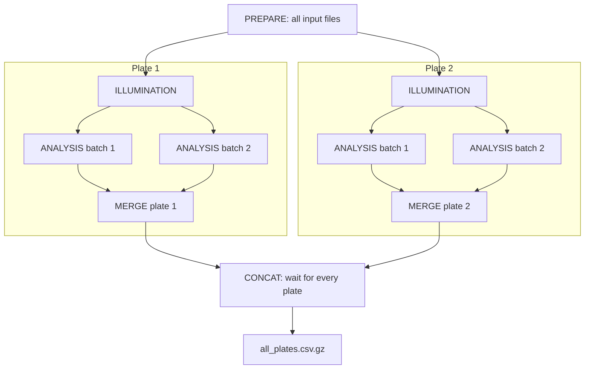
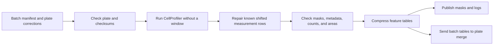

# How jobs run

Nextflow starts each job when its inputs are ready and execution resources are available.
A job is one execution of a process. A process is a named step in `main.nf`.

## Dependencies between plates

Each plate's analysis waits for that plate's illumination files.
It does not wait for other plates to finish illumination.
A plate merge waits for all batches from its own plate.
CONCAT waits for every plate merge. Resource limits can still delay any ready job.

## What each step does

| Process | Jobs | Actions and outputs |
|---|---|---|
| PREPARE | One per run | Check filenames, channels, dimensions, and pipelines. Write manifests, batch plan, adapted pipelines, and contract. |
| ILLUMINATION | One per plate | Read every image set of that plate. Save one correction array per channel after the last cycle. Check shape and finite values. |
| ANALYSIS | One per batch | Check correction checksums. Correct images, segment objects, measure features, save masks, and validate tables. |
| MERGE | One per plate | Require validated batches. Join cell, nucleus, cytoplasm, and image measurements into a temporary plate table. |
| CONCAT | One per run | Require matching columns. Join plate tables in name order into the published compressed table. |

A batch contains consecutive complete image sets from one plate.
It never splits channels or mixes plates.
For P plates and B total analysis batches, a successful run requires `2 + 2P + B` tasks, excluding retries.
B is the sum of each plate's image-set count divided by batch size, rounded up separately for each plate.

## What happens inside an analysis job

The repair handles a known CellProfiler 4.2.8.1 behavior for objects without pixels.
It moves shifted shape and texture values back to their object rows and records the changes.
An unexpected shift pattern stops the task rather than accepting uncertain measurements.

The local executor runs jobs on the current machine.
The Berzelius executor submits them to Slurm, the cluster's job scheduler.
Both profiles retry task exit statuses 137 and 143 within their retry limits.
Other failures terminate the workflow. A retry uses the same resource request.
A killed CellProfiler child can produce a Python failure with a different status, so it may not trigger automatic retry.

See [resources](../reference/resources.md), [outputs](../output.md), and [design limits](design.md).
