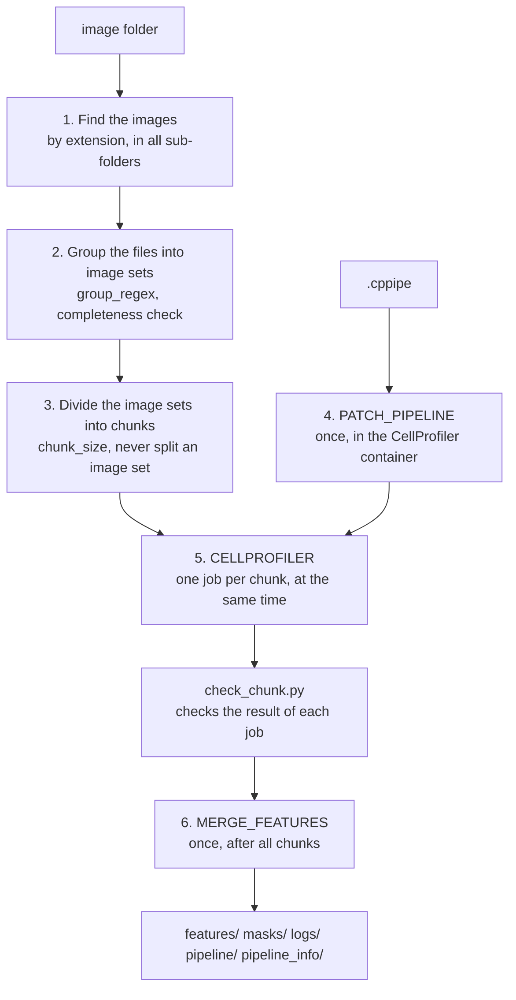

# How the workflow works

This page explains each step of the workflow: what it does, which tool runs it, and why. The code is in
[`main.nf`](https://github.com/mirandaresearchlab/headless-cp-wf/blob/main/main.nf).

## 1. Find the images

**Tool:** Nextflow. The workflow searches `--input_dir` and all its sub-folders for files with one of the
extensions in `--extensions`. It skips hidden files. Each file becomes its path relative to the image folder,
for example `plate1/A01_s1_w1.tif`.

## 2. Group the files into image sets

**Tool:** Nextflow. The capture groups of `--group_regex` make a key for each file. Files with the same key
belong to the same site and form one image set. Without `--group_regex`, each file is an image set of its own.

Then the workflow checks the image sets. Every file must match the pattern, and every image set must have the
same number of files (the most common number is the channel count). Otherwise the run stops, unless
`--allow_incomplete_sets true`. **Why:** a site with a missing channel, or a stray file in the image folder,
gives image sets that CellProfiler cannot build correctly.

## 3. Divide the image sets into chunks

**Tool:** Nextflow. The workflow sorts the image sets by key and cuts them into chunks of `--chunk_size`
image sets (0 = one chunk). A chunk always holds complete image sets. **Why sorted:** the chunks are the same
in each run, which `-resume` needs.

## 4. Prepare the pipeline (PATCH_PIPELINE)

**Tool:** `bin/patch_cppipe.py`, with CellProfiler's own Python API, in the CellProfiler container. It runs
once per run.

1. Load the pipeline. Stop if CellProfiler reports any problem (for example a missing plugin).
2. Stop if `--chunk_size` is more than 0 and the pipeline has a module that needs all image sets.
3. Remove CreateBatchFiles, which stops a run without a window.
4. Move output folders that point outside the job (or into the image folder) into the job folder.
5. For each object type: add ConvertObjectsToImage (16-bit labels) and SaveImages. Masks are never
   overwritten: two image sets with the same mask file stop the run.
6. Add ExportToSpreadsheet if the pipeline has none.

The result is `pipeline/patched.cppipe`, and each change is in `pipeline/patch_report.json`. **Why:** the same
pipeline must give masks and tables in every job, and must never write into the image folder.

## 5. Run CellProfiler on each chunk (CELLPROFILER)

**Tool:** CellProfiler 4.2.8 (`cellprofiler -c -r`), then `bin/check_chunk.py`, in the CellProfiler
container. One job per chunk, all at the same time.

The job links the complete image folder as `input/`, and gives CellProfiler the list of its files
(`--file-list`). Thus the folder structure stays the same, and metadata from folder names still works.
CellProfiler can end with exit code 0 after errors. Thus `check_chunk.py` checks the outputs:

- no errors in the CellProfiler log while modules ran,
- an image table with the expected number of image sets,
- counts that agree with the object tables,
- one mask per image set and object type, and no two image sets with the same mask,
- with `--required_metadata`: present, non-empty and unique metadata.

It copies the tables, makes the mask list of the chunk, and writes `logs/qc_<chunk>.json`.

## 6. Merge the tables (MERGE_FEATURES)

**Tool:** `bin/merge_features.py`. It runs once, after all chunks. For each table name, it joins the tables of
all chunks into one table, row by row. It adds `CPNF_Chunk` and `CPNF_GlobalImageNumber`, because
CellProfiler starts `ImageNumber` at 1 in each chunk. It stops if two chunks wrote the same mask path, or (with
`--required_metadata`) if the same site occurs in two chunks.

## Errors and new tries

If a job stops because it used too much memory or time, Nextflow tries it again with more, up to 3 times. After
any other error, Nextflow starts no new jobs, but lets the running jobs finish. With `-resume`, a new run uses
their results. See [Resources](../reference/resources.md).
