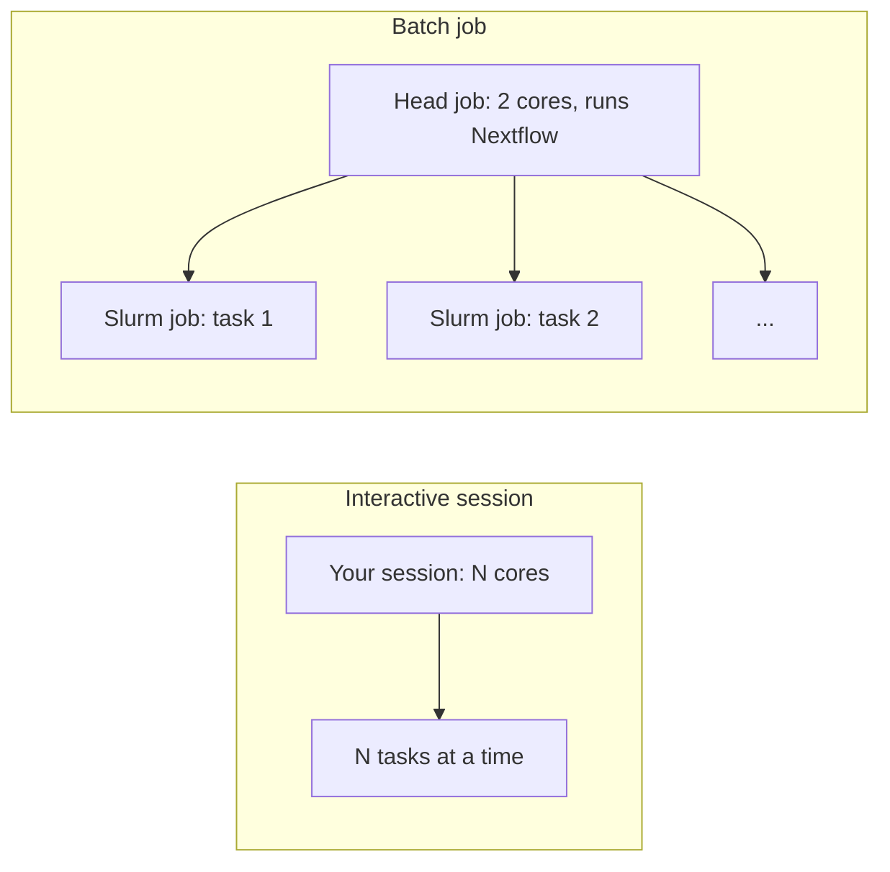

# Run on Berzelius

This page shows how to run the workflow on Berzelius, the NSC cluster in Linköping.
There are two ways to run it. Use an interactive session to test. Use a batch job for real data.

| | Interactive session | Batch job |
|---|---|---|
| Use it for | Tests and small datasets | Full plates and screens |
| Script | `scripts/berzelius-interactive.sh` | `scripts/berzelius-run.sbatch` |
| Where tasks run | Inside your session, on the cores you asked for | As separate Slurm jobs on `berzelius-cpu` |
| Nextflow profile | `local` | `berzelius` |
| Time limit | What you ask for, up to 72 hours | 72 hours, then submit again to continue |
| Stops when | You close the session or it reaches its time limit | It finishes or reaches 72 hours |



!!! note "Words used on this page"
    A **task** is one step for one plate or batch, for example ILLUMINATION for one plate.
    A **batch** is a group of image sets that one CellProfiler process analyses.
    The **head job** is the small Slurm job that runs Nextflow. It does not run CellProfiler.

## Before you start

You need:

- A Berzelius account and a project. Run `projinfo` on the login node to see your Slurm account.
- A copy of this repository in your project folder, `/proj/<project>/users/$USER`.
- Your images in `/proj`, with one folder per plate. See [usage](../usage.md) for the folder layout.

!!! warning "Rules on Berzelius"
    - Do not run CellProfiler or install software on the login node. Use an interactive session or a batch job.
    - Keep the environment, work files and results in `/proj`. Your home folder holds only 20 GB and 1 million files.
    - Do not put sensitive data, for example personal data, on Berzelius.

The scripts keep everything in `/proj/berzelius-2025-380/users/$USER`.
If your project folder is different, set `PROJ` before you run a script:

```bash
export PROJ=/proj/<project>/users/$USER
```

## Set up once

Do these steps one time. They create a conda environment with CellProfiler and Nextflow.

1. Start an interactive session with 4 cores (on the login node):

    ```bash
    interactive -A <account> -p berzelius-cpu -n 1 -c 4 -t 01:00:00
    ```

2. Go to the repository folder:

    ```bash
    cd /proj/<project>/users/$USER/headless-cp-wf
    ```

3. Load the conda module. Do this first. The `conda` and `mamba` commands do not exist before you load it.

    ```bash
    module load Miniforge3/25.3.1-0
    eval "$(conda shell.bash hook)"
    ```

4. Create the environment from `environment.yml`. This takes 5 to 15 minutes.

    ```bash
    mamba env create -f environment.yml -p /proj/<project>/users/$USER/envs/cp-headless
    conda activate /proj/<project>/users/$USER/envs/cp-headless
    ```

5. Add Nextflow to the same environment:

    ```bash
    mamba install -y -p /proj/<project>/users/$USER/envs/cp-headless \
        -c conda-forge -c bioconda "nextflow>=25.10.4" openjdk=22.0.1
    ```

    Always give `-p` with the environment path. Without it, the NSC `mamba` command stops with the message "REQUIRES an active environment".
    The `openjdk=22.0.1` pin keeps the Java version that CellProfiler installed. Nextflow also uses this Java.

6. Check the tools:

    ```bash
    nextflow -version && java -version && cellprofiler --version
    ```

    You see Nextflow 25.10.4 or later, Java 22.0.1 and CellProfiler 4.2.8.

7. Close the session:

    ```bash
    exit
    ```

!!! note "Why Nextflow and CellProfiler share one environment"
    Nextflow is a Java program. It does not use Python, so it does not conflict with CellProfiler's Python 3.9.
    The workflow tasks use the `cellprofiler` and `python` commands of the environment that starts Nextflow.
    One environment makes sure that both are available.

## Test in an interactive session

Use this to test the workflow, a pipeline change or new resource settings.
Nextflow runs all tasks inside your session. It runs one task on each core at the same time.

1. Start a session (on the login node). This example asks for 18 cores for 1 hour:

    ```bash
    interactive -A <account> -p berzelius-cpu -n 1 -c 18 -t 01:00:00
    ```

2. Go to the repository folder and run the script:

    ```bash
    cd /proj/<project>/users/$USER/headless-cp-wf
    bash scripts/berzelius-interactive.sh /proj/<project>/users/$USER/my-images my-test 1
    ```

    The arguments are the image folder, the project name and the batch size.
    The batch size is optional. The default is 1.
    The script loads the module and activates the environment for you.

3. Check the first line of output. It shows what the run uses:

    ```text
    Job 17966667: 18 cores, 126 GB, images /proj/<project>/users/<user>/my-images, batch_size 1, project my-test
    ```

4. When the run is complete, close the session:

    ```bash
    exit
    ```

!!! warning "Close the session when the run stops"
    Berzelius charges every core of the session while the session is open. It charges the cores also when they do nothing.

### Choose the number of cores and the batch size

The number of cores is the number of batches that run at the same time.
For a test, use a few plates with a small number of image sets.
The examples below use 3 plates with 18 image sets each (54 image sets).

| Cores (`-c`) | Batch size | Result |
|---|---|---|
| 18 | 1 | 18 image sets at the same time. Each image set gets its own core. |
| 54 | 1 | All 54 image sets at the same time. |
| 6 | 3 | 6 batches of 3 image sets at the same time. |

One CellProfiler process uses one core. More cores for one batch do not make it faster.
Each task gets 7 GB of memory and a 2-hour time limit.
A batch size of 1 starts CellProfiler once for each image set. This adds about 20 seconds to each task.

With 18 cores and batch size 1, a benchmark run of these 54 image sets took 22 minutes and 5.1 core-hours.

## Run a full screen with a batch job

Use this for real data. You submit one small head job. The head job runs Nextflow.
Nextflow submits each CellProfiler task as its own Slurm job on `berzelius-cpu`.

1. Test the pipelines first in an interactive session. See [Test in an interactive session](#test-in-an-interactive-session).

2. Go to the repository folder on the login node:

    ```bash
    cd /proj/<project>/users/$USER/headless-cp-wf
    ```

3. Submit the head job:

    ```bash
    sbatch -A <account> scripts/berzelius-run.sbatch /proj/<project>/users/$USER/my-images screen01 9
    ```

    The arguments are the image folder, the project name and the batch size.
    The batch size is optional. The default is 9.

4. Watch the jobs:

    ```bash
    squeue -u $USER                  # the head job (cp-headless) and its task jobs
    tail -f cp-headless-<jobid>.log  # Nextflow progress
    ```

You can close your terminal. The head job continues without you.

### Check the job

| Question | Command |
|---|---|
| Is the job running? | `squeue -u $USER` |
| Which node does each job use? | `squeue -u $USER -o "%.10i %.25j %.3t %.10M %R"` |
| How many tasks run on each node? | `squeue -u $USER -t R -h -o "%N" \| sort \| uniq -c` |
| Did a finished job succeed? | `sacct -u $USER -S today --format=JobID,JobName%25,State,Elapsed,ExitCode,NodeList` |
| What is Nextflow doing? | `tail -n 30 cp-headless-<jobid>.log` |

In `squeue`, `R` means the job runs and `PD` means it waits. For a waiting job, the last column shows the reason.
The run is complete when these three things are true:

1. The head job `cp-headless` is no longer in `squeue`.
2. `sacct` shows `COMPLETED` and the exit code `0:0` for the head job.
3. The end of the log shows `[SUCCESS] completed=<N> failed=0`.

### Choose resources for a full screen

In the benchmark run, one image set took 4.4 to 6.7 minutes on one core (5.4 minutes on average).
It used 3.4 to 5.0 GB of memory.
Make each task run for 15 to 60 minutes. Fewer, longer tasks wait less time in the queue.

| Setting | Default | Suggestion for a full screen |
|---|---|---|
| Batch size | 9 | 9. One task then runs for about 50 minutes. |
| `--task_time` | 4 hours | 2 hours |
| `--task_memory` | 6 GB | 7 GB. The largest benchmark task used 5.0 GB. A CPU core comes with about 7.7 GB, so 7 GB still costs one core. |
| `--max_jobs` | 8 | 64 to 96. This is the number of tasks that run at the same time. All users share the 8 CPU nodes. Ask the group before you use more than 96. |

To change a setting, add it after the batch size:

```bash
sbatch -A <account> scripts/berzelius-run.sbatch /proj/<project>/users/$USER/my-images screen01 9 \
    --task_time 2h --task_memory '7 GB' --max_jobs 96
```

### Estimate the run time and the cost

1. Count the image sets. An image set is all channels of one site. For example, 17,000 images with 5 channels are 3,400 image sets.
2. Calculate the core-hours: image sets × 5.4 minutes ÷ 60. For 3,400 image sets, this is about 310 core-hours.
3. Calculate the time: core-hours ÷ `--max_jobs`. Add about 3 hours for illumination, MERGE and CONCAT.

| Example: 3 plates of 3,400 image sets (930 core-hours) | Time |
|---|---|
| `--max_jobs 8` | About 5 days |
| `--max_jobs 32` | About 32 hours |
| `--max_jobs 64` | About 17 hours |
| `--max_jobs 96` | About 13 hours |
| `--max_jobs 128` | About 10 hours |

The cost in core-hours is the same for each `--max_jobs` value. More jobs only make the run finish sooner.
Run `projinfo` to see your monthly allocation.
These numbers come from the benchmark run (about 430 cells for each image set). Plates with more cells take longer.
Time in the queue is not included.

Plan the disk space too. The benchmark run used about 33 MB of work files and 15 MB of final table for each image set.
For 10,200 image sets, this is about 500 GB in addition to the images.
Run `nscquota` to see the free space. Use the quota that `nscquota` shows. The size that `df` shows is larger than the quota.
If the free space is too small, [run one plate at a time](#run-one-plate-at-a-time-when-disk-space-is-short).

All settings are in [parameters](../reference/parameters.md).

## Run one plate at a time when disk space is short

A normal batch job keeps the work files of all plates until the run is complete.
If the project quota is too small for this, run the plates one after another.
The script `scripts/berzelius-run-plates.sbatch` does this in one head job.
Only the work files of one plate exist at any time.

A plate needs about 0.05 GiB for each image set. A plate of 3,420 image sets needs about 170 GiB.
Check the free space with `nscquota` before you submit.

Submit from the repository folder:

```bash
DATA=/proj/<project>/users/$USER/my-images \
OUT=/proj/<project>/users/$USER/results/screen01 \
MAX_JOBS=96 \
sbatch -A <account> scripts/berzelius-run-plates.sbatch
```

`DATA` is the folder with one folder per plate. `OUT` is the results folder.
To run only some plates, add their folder names at the end of the command.
The settings `BATCH_SIZE`, `TASK_MEMORY` and `TASK_TIME` work in the same way.
The defaults are the values in [Choose resources for a full screen](#choose-resources-for-a-full-screen).

For each plate, in alphabetical order, the script does these steps:

1. It skips the plate if the file `OUT/<plate>/DONE` exists.
2. It checks that enough space is free. If not, it stops before it writes any file.
3. It runs the workflow for this plate. The tasks of the plate run in parallel, as in a normal batch job.
4. It deletes the work files of the plate. It does this only if the workflow reports success and the final table exists.
5. It writes the file `OUT/<plate>/DONE`, which contains the path of the results.

Each plate gets its own table: `OUT/<plate>/projects/<folder>/cp_features/all_plates.csv.gz`.
To see the result path of each plate, run `cat OUT/*/DONE`.

If a plate fails, the script stops and keeps the work files of this plate.
Fix the cause and submit the same command again. The script skips the finished plates and resumes the failed plate.

!!! warning "You cannot resume a finished plate"
    The script deletes the work files of a finished plate. To run this plate again, delete its `DONE` file and the plate folder in `OUT`.

!!! note "The space check can be skipped"
    `nscquota` sometimes returns no answer. The script tries three times. Then it prints a warning and starts the plate without the check.
    Check the free space yourself before you submit.

The plates run one after another, so the run takes longer than one run for all plates.
If enough space is free, use the normal batch job.

## Find the results

Both scripts write to the same places:

| What | Where |
|---|---|
| Results | `$PROJ/runs/projects/<folder>/`. The folder is usually a session ID, not the project name. The log shows the path after `Outputs:`. |
| Time and memory of each task | `$PROJ/runs/projects/<project_name>/report/trace.txt` |
| Nextflow work files | `$PROJ/runs/<project_name>-work/` |
| Nextflow log | `$PROJ/runs/<project_name>-launch/.nextflow.log` |

To find the results folder, run `grep Outputs: cp-headless-<jobid>.log`.
Each project starts Nextflow from its own `-launch` folder. For this reason, two projects never share a session or a results folder.

See [output](../output.md) for what each result file contains.

!!! note "File quota"
    Each task leaves about 10 files in the work folder. Run `nscquota` to check your quota.
    Keep the work folder until you no longer need to resume the run.

## Continue a stopped run

Run the same command again. Both scripts use `-resume`.
Nextflow skips the tasks that are complete and runs only the remaining tasks.
For example, if ILLUMINATION is complete and ANALYSIS stops, the new run starts at ANALYSIS.

Use the same project name. Do not delete the work folder.

| If you change | What runs again |
|---|---|
| `--task_memory`, `--task_time` or the number of cores | Nothing. You can resume with more memory after a memory failure. |
| `2_analysis.cppipe` | ANALYSIS and the steps after it. Nextflow keeps the illumination results. |
| `1_illumination.cppipe` | ILLUMINATION and all steps after it. |
| The batch size | All steps, also illumination. |
| A file in `bin/` | All steps. |
| The project name | All steps. A new name is a new run. |

A batch job stops after 72 hours. Submit the same `sbatch` command again to continue.

## Fix common problems

| Problem | Cause | Fix |
|---|---|---|
| `conda: command not found` or `mamba: command not found` | The module is not loaded | Run `module load Miniforge3/25.3.1-0` first. |
| `REQUIRES an active environment` | The NSC `mamba` command needs the environment path | Add `-p <environment path>` to `mamba install`. |
| `nextflow: command not found` | Nextflow is not in the environment | Do step 5 of [Set up once](#set-up-once). |
| `Not a conda environment` | The environment does not exist, or `PROJ` is wrong | Do [Set up once](#set-up-once), or set `PROJ`. |
| `Not in a Slurm job` | You ran the interactive script on the login node | Start an interactive session first. |
| The script shows fewer cores than you expected | The session has fewer cores | Close it and start a new session with a larger `-c`. |
| Task jobs stay `PENDING` | The CPU nodes are busy | Wait. Run `squeue -u $USER` to see the reason. |
| Exit status 137 or 143 | The task used too much memory or time | Read `trace.txt`. Increase `--task_memory` or `--task_time` and resume. |
| `needs about N GiB, but only M GiB is free` | The plate script found too little free space | Free space in the project, then submit the same command again. |
| `nscquota gave no answer` | `nscquota` failed three times | Check the free space with `nscquota`. The run is not stopped. |
| `Set DATA ... and OUT` | The plate script needs both settings | Set `DATA` and `OUT` in the command. |

For other errors, see [troubleshooting](troubleshooting.md).
For questions about cores, memory, cost and nodes, see the [Berzelius FAQ](berzelius-faq.md).
Berzelius support: berzelius-support@nsc.liu.se. Give the job ID, the command and the full error.

??? info "Run without the scripts"
    The scripts run these Nextflow commands. Activate the environment first.

    Interactive session (local executor):

    ```bash
    nextflow run . -profile local -resume \
      --images <images> --configs cp-configs \
      --outdir $PROJ/runs --project <project_name> \
      --nf_work_dir $PROJ/runs/<project_name>-work \
      --total_cpus <cores> --total_memory '<cores x 7> GB' --batch_size 1
    ```

    Head job (Slurm executor):

    ```bash
    nextflow run . -profile berzelius -resume \
      --images <images> --configs cp-configs \
      --outdir $PROJ/runs --project <project_name> \
      --nf_work_dir $PROJ/runs/<project_name>-work \
      --conda_cache $PROJ/runs/conda-cache \
      --slurm_account <account>
    ```
