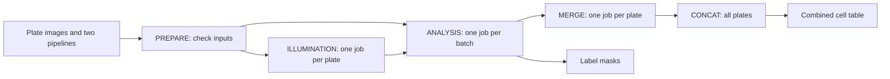

# Headless CellProfiler

This workflow turns microscopy images into cell measurements without opening the CellProfiler window.

You supply one folder per plate and two CellProfiler pipeline files.
The workflow corrects uneven lighting, finds objects, measures them, and checks the outputs.
It saves label masks and one compressed CSV table with one row per cell.

## Start here

1. Follow [installation](getting-started/installation.md).
2. Complete the [first-run tutorial](tutorials/first-run.md).
3. [Run your own images](usage.md).
4. Read [outputs and checks](output.md) before using the measurements.

For failures, use [troubleshooting](how-to/troubleshooting.md).
For job dependencies, read [how jobs run](explanation/workflow.md).

## What this version supports

| Item | Support |
|---|---|
| Input images | Single-plane, unsigned 8-bit or 16-bit grayscale TIFFs |
| Default channels | DNA, RNA, AGP, Mito, ER |
| Segmentation | Traditional nuclei detection and watershed cell segmentation |
| Execution | Local workstation or the supplied Berzelius Slurm profile |
| CellProfiler | Exactly 4.2.8.1 for both CellProfiler packages |
| Nextflow | At least 25.10.4 in the repository configuration |

There is no `test` profile. Test images are a separate dataset.
See [validation status](about/contributing.md#validation-status) for what was checked in this documentation update.
