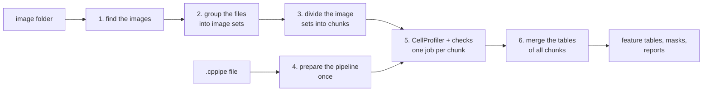

# cp-headless

cp-headless measures cells in large sets of microscope images. It runs **CellProfiler** without its
graphical window ("headless"). It uses **Nextflow** to run many CellProfiler jobs at the same time, on a
lab workstation or on the Berzelius cluster.

You give the workflow a **CellProfiler pipeline** (a `.cppipe` file that you made in the CellProfiler
program) and a **folder of images**. The workflow gives you feature tables, segmentation masks and
reports. These tables are the input for **image-based profiling**, where you compare the measurements of
cells between treatments. Wrong or missing data gives wrong biology, so the workflow checks the data at
each step and stops when something is wrong.

## At a glance

| | |
| --- | --- |
| **Input** | A CellProfiler pipeline (`.cppipe` / `.cpproj`, CellProfiler 4.2.8) and a folder of images |
| **Output** | Merged feature tables (one row per image, one row per object), 16-bit segmentation masks, a mask list, check reports |
| **Runs on** | A lab workstation with Ubuntu (with or without Docker) and the Berzelius cluster (interactive or Slurm batch, with Apptainer) |
| **Software** | Nextflow 24.04 or newer, Java 17 to 26, CellProfiler 4.2.8 in a container pinned by digest |
| **Status** | Version 1.0.0 |

## How it works



[How the workflow works](explanation/workflow.md) explains each step. The checks that protect your
data are in [Data checks and design](explanation/design.md).

## Quickstart

On a lab workstation, after [Installation](getting-started/installation.md):

```bash
nextflow run . -profile test,local -c local.config     # without Docker (see Run without Docker)
nextflow run . -profile test,docker                    # with Docker (see Run with Docker)
```

Each command runs CellProfiler on 6 small test images. The tables in `results_test/features/` then have
6 image sets and 51 nuclei. The [tutorial](tutorials/first-run.md) shows the results and explains them.
On Berzelius, start with [Berzelius: set up](how-to/berzelius-setup.md).

## Where next

- **New here?** Read [Installation](getting-started/installation.md), then do the [tutorial](tutorials/first-run.md).
- **Ready for your own images?** Read [Run on your data](usage.md) and [Output](output.md).
- **Where do I run it?** See [Find your guide](how-to/index.md): lab workstation or Berzelius.
- **Looking something up?** See the [parameters](reference/parameters.md) and the [file formats](reference/file-formats.md).
- **Want to understand the design?** See [How the workflow works](explanation/workflow.md).
- **New words?** See the [glossary](reference/glossary.md).
